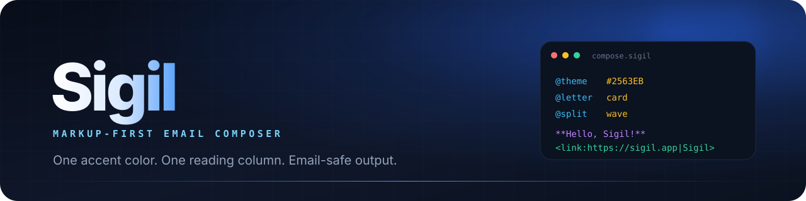
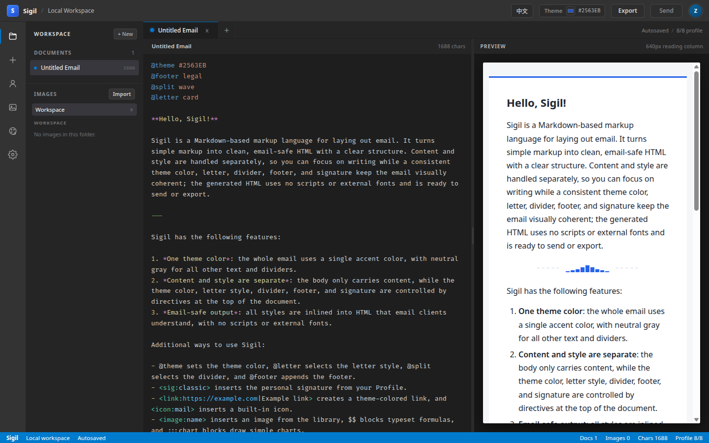
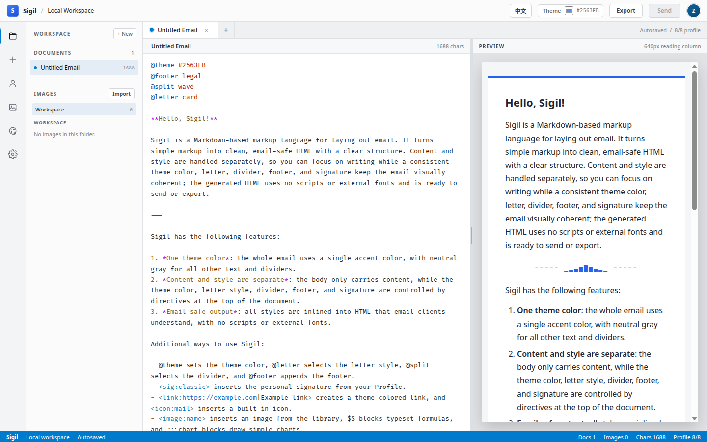

<p align="center">
  
</p>

<p align="center">
  <a href="docs/SPEC.md"><strong>规范</strong></a>
  &nbsp;·&nbsp;
  <a href="#快速开始"><strong>快速开始</strong></a>
  &nbsp;·&nbsp;
  <a href="#语法速览"><strong>语法</strong></a>
  &nbsp;·&nbsp;
  <a href="https://github.com/lazypool/Sigil/issues"><strong>Issues</strong></a>
  &nbsp;·&nbsp;
  <a href="README.md"><strong>English</strong></a>
</p>

<p align="center">
  
  
  
  
</p>

<h3 align="center">像写文档一样写邮件，交付能在任何收件箱里存活的 HTML。</h3>

<p align="center">
  Sigil 是一款围绕小巧、可读的标记语言构建的桌面邮件排版工具。
  它把内容与样式分离，实时渲染邮件安全预览，不需要你手写 table 布局。
</p>

---



<p align="center"><sub>语法高亮编辑器、实时 640px 预览、标签页、图片库，以及来自 Profile 的签名。</sub></p>

## 为什么选择 Sigil

| 原则 | 含义 |
| --- | --- |
| **标记，而非格式化** | 段落、强调、列表、链接、图片、签名、公式和图表都用纯文本表达。 |
| **默认邮件安全** | 渲染器只生成 table 和内联 CSS，不依赖脚本、外部字体、flexbox 或 grid。 |
| **单一强调色** | 整封邮件共用一个主题色，其余部分保持中性。 |
| **内容可迁移** | 文档本身就是文本。样式放在头部指令，个人资料放在 Profile，版式交给主题。 |
| **本地优先** | 文档、打开的标签页、分栏位置、Profile 字段、偏好设置和图片都会自动保存在浏览器存储中。 |

## 核心功能

- **完整工作区** —— 多文档、可重新打开的文档列表、标签页，以及自动保存的编辑/预览分栏。
- **实时预览** —— 每次按键都会重新解析文档，并重建沙箱中的邮件预览。
- **语法高亮** —— 头部指令、分隔线、列表、强调、插入、链接和块级结构都会着色。
- **Profile 标签页** —— 姓名、联系方式、教育经历、链接和头像共同驱动签名，个人数据不会写进文档。
- **图片库** —— 把图片导入嵌套文件夹，并通过 `<image:...>` 按名称插入。
- **样式预设** —— 预览并应用信纸、页脚、分隔符和签名样式到当前文档。
- **外观控制** —— 深色/浅色主题、强调色、紧凑度、编辑器字号，以及中英文界面。
- **HTML 导出** —— 通过浏览器保存对话框导出邮件安全 HTML。

| 模块 | 说明 |
| --- | --- |
| **编辑器** | 尽力解析并显示诊断信息，语法高亮层与滚动同步，插入内容会跟随光标。 |
| **预览** | 100% 宽度外层 table，居中的 `max-width: 640px` 阅读栏，16px 正文、1.7 行高，无脚本。 |
| **文档** | 双语起始模板、多个可恢复标签页，以及自动保存的本地元数据。 |
| **Profile** | 共享的个人资料字段驱动签名主题；上传的头像会出现在标题栏和签名中。 |

## 语法速览

~~~text
@theme #2563EB
@footer legal
@split wave
@letter card

**你好，Sigil！**

Sigil 是一款 *标记优先* 的邮件排版工具。它把简单的文本转换成
结构清晰的邮件安全 HTML，只使用一个强调色和固定阅读栏。

---

1. *单一主题色*：整封邮件共用一个强调色。
2. *声明式排版*：信纸、页脚、分隔符和签名都在头部选择。
3. *可移植输出*：内联 CSS、table 结构，不依赖脚本。

- <link:https://github.com/lazypool/Sigil|查看源码>
- <icon:mail> 插入内置图标
- <image:product.png> 插入图片库中的图片

<sig:classic>

```
Hello, Sigil!
This block is plain text, not code, and keeps its line breaks.
```
~~~

完整语法——包括中英文换行拼接、列表宽度检查、公式与图表块、诊断和主题 id——见 [`docs/SPEC.md`](docs/SPEC.md)。

## 快速开始

**环境要求：** MoonBit 工具链（`moon`）、Proton CLI/运行时，以及 Warren 前端开发服务器。

```sh
git clone https://github.com/lazypool/Sigil.git
cd Sigil

moon install moonbit-community/proton_cli
moon install moonbit-community/warren@0.4.5

moon check
moon test
proton_cli dev
```

`proton_cli setup` 会准备共享的 CEF 运行时。打开桌面窗口前，请先安装对应平台的原生构建依赖（例如 Linux 上的 GTK 3 和 CEF 依赖）。

其他检查：

```sh
proton_cli build
proton_cli package --dry-run
```

## 项目结构

```text
sigil/
├── docs/
│   ├── SPEC.md             # 语言规范
│   ├── banner.svg          # README 横幅
│   └── sigil*.png          # 工作区截图
├── src/
│   ├── core/
│   │   ├── types/          # AST、诊断和 Profile 类型
│   │   ├── parser/         # 手写 Sigil 标记解析器
│   │   ├── highlight/      # 编辑器语法高亮分词器
│   │   ├── render/         # 邮件安全 HTML 渲染器和预览外壳
│   │   ├── linter/         # 预留给检查器阶段
│   │   └── themes/         # 预留给主题包阶段
│   ├── frontend/           # Rabbita 工作区、标签页、编辑器和预览
│   └── backend/            # Proton 原生桌面外壳
├── moon.mod
├── moon.work
└── proton.project.json
```

## 浅色主题，同样的阅读栏

<p align="center">
  
</p>

## 项目状态

Stage 0 已经是一个完整的本地写作工作区。接下来的里程碑包括检查器、主题包、原生存储和 SMTP 发送。

## 许可证

Apache-2.0。详见项目元数据或 [Apache License 2.0](https://www.apache.org/licenses/LICENSE-2.0)。
