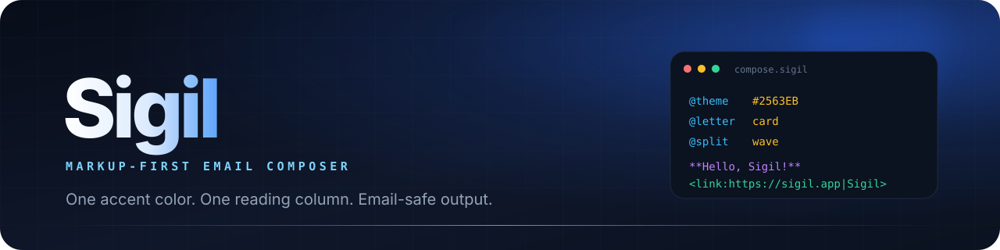
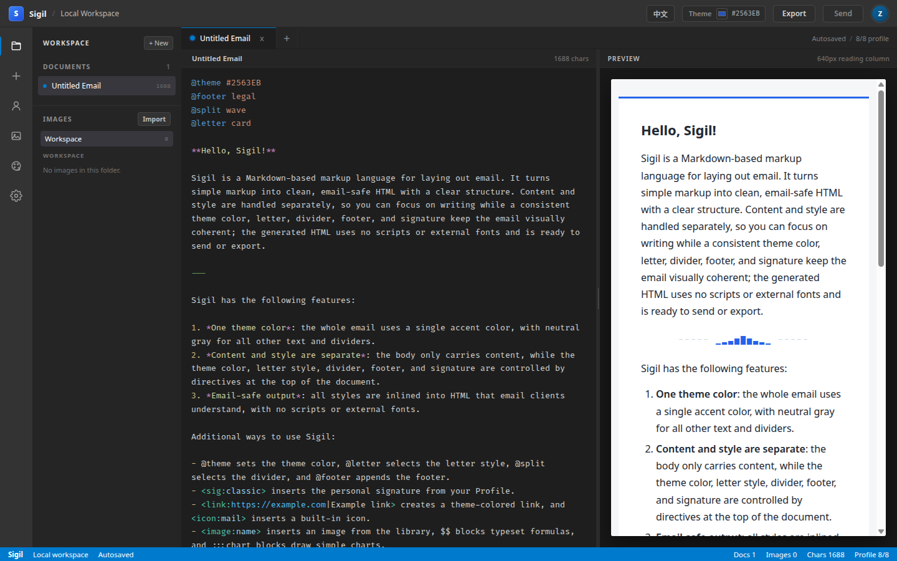
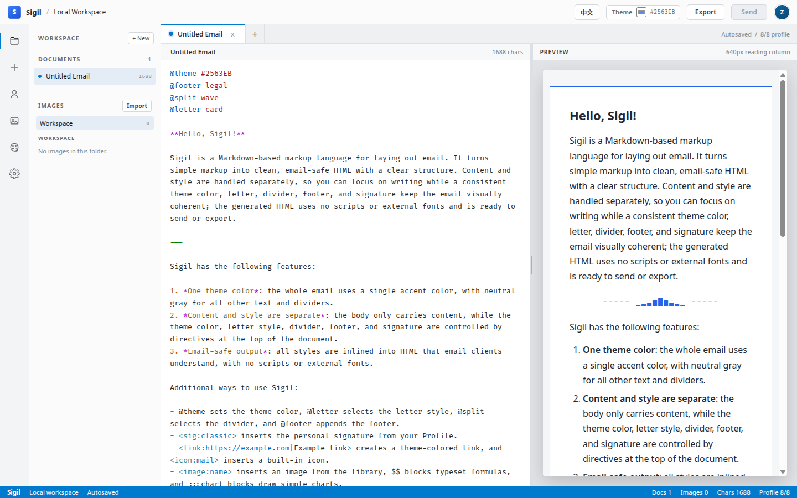

<p align="center">
  
</p>

<p align="center">
  <a href="docs/SPEC.md"><strong>Specification</strong></a>
  &nbsp;·&nbsp;
  <a href="#quick-start"><strong>Quick start</strong></a>
  &nbsp;·&nbsp;
  <a href="#syntax-at-a-glance"><strong>Syntax</strong></a>
  &nbsp;·&nbsp;
  <a href="https://github.com/lazypool/Sigil/issues"><strong>Issues</strong></a>
  &nbsp;·&nbsp;
  <a href="README-zh.md"><strong>简体中文</strong></a>
</p>

<p align="center">
  
  
  
  
</p>

<h3 align="center">Write email like a document. Ship HTML that survives every inbox.</h3>

<p align="center">
  Sigil is a desktop email composer built around a small, readable markup language.
  It keeps content separate from style, renders a live email-safe preview, and
  never asks you to hand-write table layouts.
</p>

---



<p align="center"><sub>Syntax-highlighted editor, live 640px preview, tabs, image library, and profile-backed signatures.</sub></p>

## Why Sigil

| Principle | What it means |
| --- | --- |
| **Markup, not formatting** | Paragraphs, emphasis, lists, links, images, signatures, formulas, and charts are expressed as plain text. |
| **Email-safe by default** | The renderer produces tables and inline CSS, without scripts, external fonts, flexbox, or grid. |
| **One accent color** | The whole message shares a single theme color; everything else is neutral. |
| **Content stays portable** | Documents are text. Style decisions live in the header, profile data lives in the profile, and layouts belong to themes. |
| **Local-first workspace** | Documents, open tabs, split position, profile fields, preferences, and each email's images and tables autosave in browser storage. |

## What is inside

- **A real workspace** — multiple documents, a reopenable document list, tabs, and an autosaved editor/preview split.
- **A live preview** — every keystroke reparses the document and rebuilds a sandboxed email preview.
- **Syntax highlighting** — header directives, dividers, lists, emphasis, insertions, links, and block constructs are color-coded.
- **A profile tab** — name, contact details, education, links, and avatar feed signatures without putting personal data in the document.
- **Per-email libraries** — every email owns its own flat Images and Tables lists; library tabs group resources by email, images open inline previews, and tables open a simplified inline editor with content-based column widths and a column limit.
- **A table library** — import CSV, XLSX, XLS, ODS, or JSON files as CSV and insert them with `<table:name.csv>`. Tables are hard-limited to 5 columns and 60 characters per cell; wider or longer data is split or truncated on import.
- **Style presets** — preview and apply letter, footer, divider, and signature styles to the active document.
- **Appearance controls** — dark/light themes, accent color, density, editor font size, and English/Chinese UI chrome.
- **HTML export** — save the rendered email-safe HTML through the browser save dialog.

| Area | Details |
| --- | --- |
| **Editor** | Best-effort parsing with diagnostics, synchronized syntax overlay, and cursor-aware insertions. |
| **Preview** | 100% width outer table, centered `max-width: 640px` column, 16px body text at 1.7 line height, no scripts. |
| **Documents** | Bilingual starter template, multiple restored tabs, and autosaved local metadata. |
| **Profile** | Shared profile fields feed signature themes; uploaded avatar appears in the title bar and signature. |

## Syntax at a glance

~~~text
@theme #2563EB
@footer legal
@split wave
@letter card

**Hello, Sigil!**

Sigil is a *markup-first* email composer. It turns simple text into
clean, email-safe HTML with one accent color and a fixed reading column.

---

1. *One theme color*: the whole message shares a single accent.
2. *Declarative layout*: letter, footer, divider, and signature are selected in the header
3. *Portable output*: inline CSS, tables, and no scripts.

- <link:https://github.com/lazypool/Sigil|View the source>
- <icon:mail> Insert a built-in icon
- <image:product.png> Insert a library image

<sig:classic>

```
Hello, Sigil!
This block is plain text, not code, and keeps its line breaks.
```
~~~

The full grammar — CJK line joining, list width checks, formula and chart blocks, diagnostics, and theme ids — lives in [`docs/SPEC.md`](docs/SPEC.md).

## Quick start

**Requirements:** the MoonBit toolchain (`moon`), the Proton CLI/runtime, and the Warren frontend dev server.

```sh
git clone https://github.com/lazypool/Sigil.git
cd Sigil

moon install moonbit-community/proton_cli
moon install moonbit-community/warren@0.4.5

moon check
moon test
proton_cli dev
```

`proton_cli setup` prepares the shared CEF runtime. Install the native build prerequisites for your platform (for example GTK 3 and CEF dependencies on Linux) before opening the desktop window.

Useful checks:

```sh
proton_cli build
proton_cli package --dry-run
```

## Project layout

```text
sigil/
├── docs/
│   ├── SPEC.md             # language specification
│   ├── banner.svg          # README artwork
│   └── sigil*.png          # workspace screenshots
├── src/
│   ├── core/
│   │   ├── types/          # AST, diagnostics, and profile types
│   │   ├── parser/         # handwritten Sigil markup parser
│   │   ├── highlight/      # editor syntax tokenizer
│   │   ├── render/         # email-safe HTML renderer and preview shell
│   │   ├── linter/         # reserved for the linter stage
│   │   └── themes/         # reserved for the theme-pack stage
│   ├── frontend/           # Rabbita workspace, tabs, editor, preview
│   └── backend/            # Proton native desktop shell
├── moon.mod
├── moon.work
└── proton.project.json
```

## Light theme, same reading column

<p align="center">
  
</p>

## Status

Stage 0 is a complete local authoring workspace. The next milestones are linting, theme packs, native storage, and SMTP sending.

## License

Apache-2.0. See the project metadata or the [Apache License 2.0](https://www.apache.org/licenses/LICENSE-2.0).
